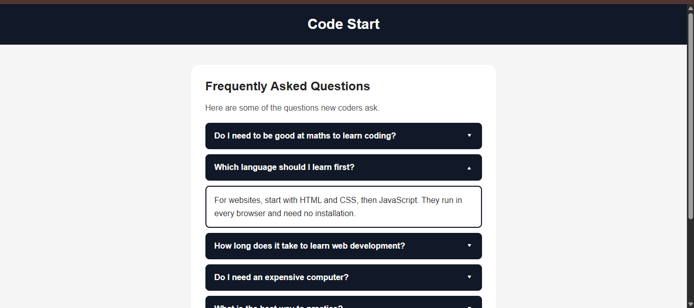

# Accordion

An accordion FAQ component built with HTML, CSS, and plain JavaScript. Each question is a button. Clicking a question opens its answer and closes any other open answer, so only one answer is open at a time. Clicking an open question closes it. The first answer is open when the page loads. The open and closed state is also kept in ARIA attributes, so screen readers announce it, and the arrow turns from the same attribute.

Project: <https://roadmap.sh/projects/accordion>

